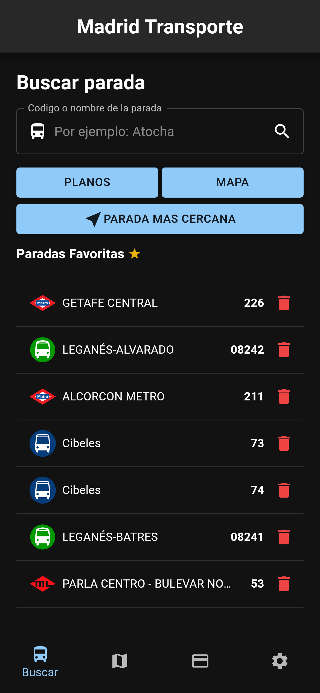
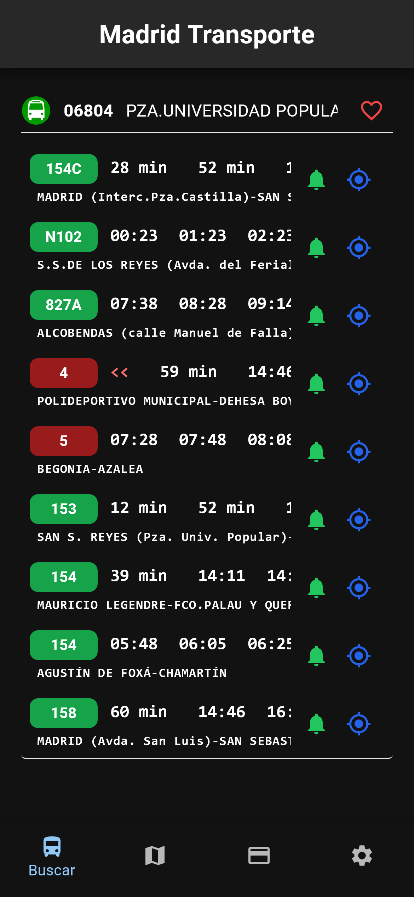
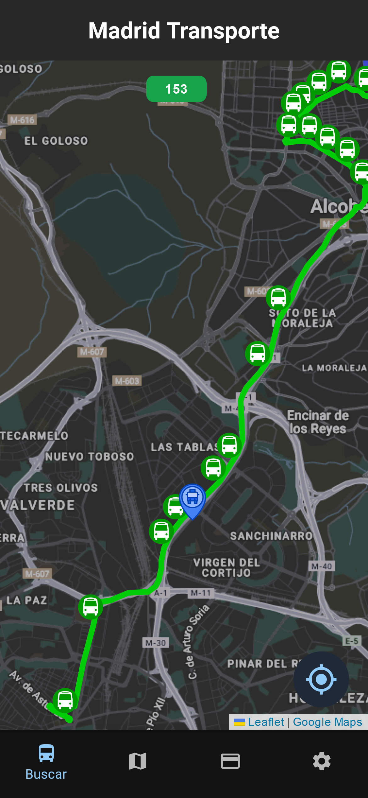
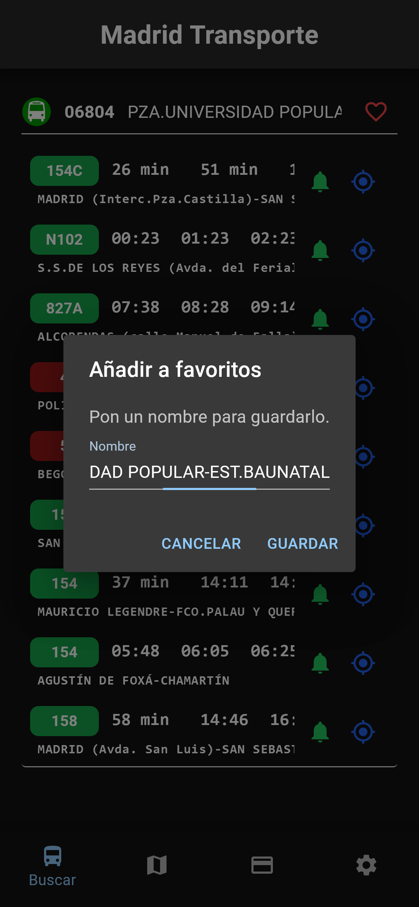
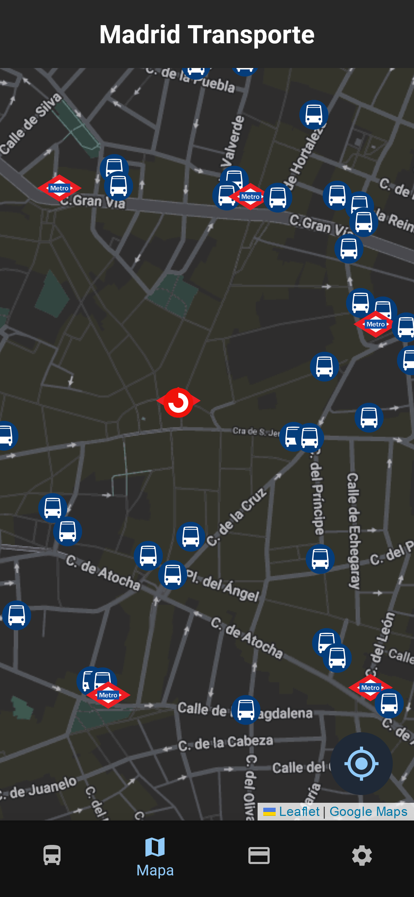
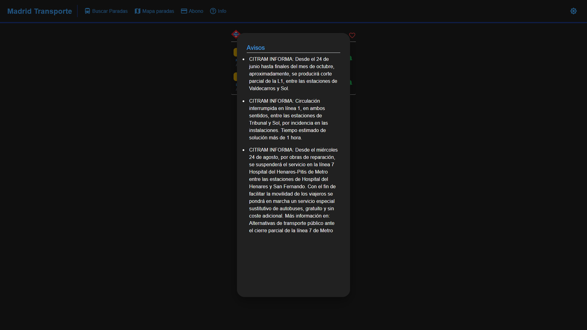

# MadridTransporte

> [!WARNING]\
> El servicio que provee la informacion se cae frequentemente, es aprovechado por empresas con animo de lucro, no se actualiza desde 2016, etc.

> [!NOTE]\
> Si crees que hay algun error que se pueda solucionar no dudes en crear una [Propuesta](https://github.com/xBaank/MadridTransporte/issues/new/choose)
> 
> Puedes leer mas sobre como funciona aqui: [¿Como funcionan los sistemas del transporte publico?](https://xbaank.github.io/blog/how-public-transport-system-work.html)

MadridTransporte es una app que te permite ver los tiempos de las paradas de EMT Madrid, Metro de Madrid, Cercanias Renfe Madrid y Autobuses urbanos e interurbanos de la Comunidad de Madrid.

## Instalacion
No necesitas instalar nada, solo tienes que ir a [MadridTransporte.com](https://madridtransporte.com)

> [!IMPORTANT]\
> Si estas en movil, puedes instalarla como una app, simplemente dandole al boton de añadir a pantalla de inicio en cualquier navegador.
> 
> Esto te permitira cargar la app mas rapido y tenerla en tu pantalla de inicio.
> 
> Tambien puedes descargar el apk desde [Aqui](https://github.com/xBaank/MadridTransporte-front/releases)

## Ventajas
- No necesitas instalar nada
- Es gratis (**SIN ANUNCIOS**)
- Es completamente **open source**
- Totalmente multiplataforma (solo necesitas un navegador)
- Ver la hora de llegada de los autobuses en vez de el tiempo restante
- Ver las locaclizaciones de los autobuses

## Permisos
- `Ubicacion`: Para poder mostrar las paradas cercanas.

# FAQ
- [¿Como puedo ver los tiempos?](#Como-puedo-ver-los-tiempos)
- [¿Como puedo ver las localizaciones?](#Como-puedo-ver-las-localizaciones)
- [¿Como puedo guardar la parada en favoritos?](#Como-puedo-guardar-la-parada-en-favoritos)
- [¿Como puedo buscar una parada en el mapa?](#Como-puedo-buscar-una-parada-en-el-mapa)
- [¿Como puedo saber si una hay alguna incidencia?](#Como-puedo-saber-si-una-hay-alguna-incidencia)

## ¿Como puedo ver los tiempos?
Simplemente introduce el nombre de la parada o su correspondiente codigo en el buscador.

Haz click en la parada que necesites y veras los tiempos de las lineas que pasan por esa parada.

## ¿Como puedo ver las localizaciones?
Dale al boton de localizacion de la linea que deseas.

## ¿Como puedo guardar la parada en favoritos?

Dale al corazon y ponle un nombre.

## ¿Como puedo buscar una parada en el mapa?

Para buscar una parada en el mapa solo tienes que darle al boton de mapa.

## ¿Como puedo saber si una hay alguna incidencia?

Para ver si hay incidencias, solo tienes que ir a la parada que vayas a usar y (si hay incidencias) te aparecera un boton de avisos.

